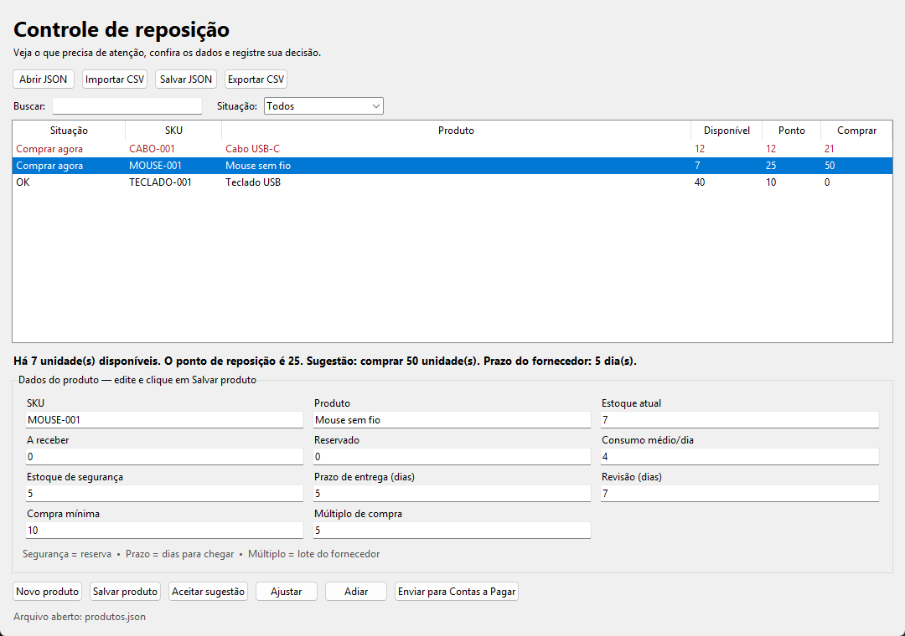

# Planejamento de Reposição de Estoque



Aplicação Python leve para acompanhar produtos e sugerir compras. Usa apenas a biblioteca padrão, incluindo Tkinter para a janela. Nenhum pedido é enviado automaticamente.

## Visão geral

Projeto de portfólio voltado à decisão de **quando e quanto repor**. Considera consumo médio, prazo de entrega, estoque de segurança e restrições do fornecedor, com interface desktop e alternativa pelo terminal.

**Tecnologias:** Python · Tkinter · dataclasses · JSON · CSV · unittest.

### Destaques técnicos

- Regras de reposição separadas da interface e da persistência.
- Quantidades ajustadas à compra mínima e aos múltiplos do fornecedor.
- Importação e exportação de dados e registro das decisões do usuário.
- Testes de cálculo, arquivos, interface e ponte de integração em `tests/`.

## Executar localmente

```bash
git clone https://github.com/LucasSMFerreira/reposicao-estoque.git
cd reposicao-estoque
```

### Interface

Requer Python 3.10 ou superior. Na pasta do projeto:

```bash
python main.py
```

A lista mostra primeiro **Comprar agora**, depois **Comprar em breve** e **OK**. Use a busca ou o filtro para achar produtos. Clique em uma linha para ver o motivo da sugestão. **Comprar em breve** é um aviso: o estoque está acima do ponto de reposição, mas pode chegar a ele antes da próxima revisão. A quantidade sugerida pode ser zero até o ponto ser atingido.

## Usar os dados

- **Novo produto** limpa o formulário. Preencha os campos e clique em **Salvar produto**.
- Para editar, selecione uma linha, altere os campos e clique em **Salvar produto**.
- **Salvar JSON** guarda a lista em um arquivo escolhido por você. Até clicar nele, mudanças no formulário não são gravadas no arquivo.
- **Abrir JSON** carrega uma lista salva. **Importar CSV** substitui a lista atual por um CSV no formato exportado pelo programa. **Exportar CSV** cria um arquivo que pode ser aberto em planilhas.
- **Aceitar sugestão**, **Ajustar** e **Adiar** registram a decisão em `decisoes.csv`, na mesma pasta do JSON aberto ou salvo. Isso não altera o estoque nem envia pedidos.

O arquivo `data/produtos.json` contém exemplos fictícios. Para trabalhar com dados reais, salve uma cópia em outro local.

## Entenda os campos

- **Estoque disponível** = atual + a receber − reservado.
- **Consumo médio/dia** = vendas médias de uma unidade por dia.
- **Estoque de segurança** = reserva para imprevistos.
- **Prazo de entrega** = dias entre comprar e receber.
- **Revisão** = dias até a próxima conferência do estoque.
- **Compra mínima** e **múltiplo** = limites do fornecedor para o tamanho do pedido.

Ponto de reposição = consumo médio/dia × prazo de entrega + estoque de segurança. Quando o disponível chega ao ponto, a sugestão cobre o prazo de entrega e o período de revisão, respeitando a compra mínima e o múltiplo.

## Terminal e testes

```bash
python main.py --cli
python main.py --cli --dados caminho/para/produtos.json
python -m unittest discover -s tests -v
```

## Estrutura

```text
main.py                 Entrada da janela e do terminal
src/database/           Leitura, gravação, CSV e decisões
src/estoque/            Produto e estoque disponível
src/reposicao/          Cálculos de reposição
src/fornecedores/       Fornecedor
src/interface/          Janela Tkinter
data/                   Exemplos fictícios
tests/                  Testes
```

A lógica permanece separada da interface para facilitar o futuro executável e a integração com previsão de demanda.

## Exemplo de cálculo

Com consumo de 10 unidades/dia, prazo de 3 dias, segurança de 5 unidades e revisão de 2 dias:

- Ponto de reposição: `ceil(10 × 3 + 5) = 35` unidades.
- Com 20 unidades disponíveis, estoque alvo: `ceil(10 × (3 + 2) + 5) = 55`.
- Necessidade: `55 − 20 = 35`. Para compra mínima de 20 e múltiplo de 10, a sugestão é **40 unidades**.

## Escopo e limites

- O programa sugere quantidades; não compra mercadorias nem efetua pagamentos.
- O consumo médio é informado, sem previsão automática integrada.
- Registrar uma decisão não altera o estoque disponível.
- O uso principal funciona sozinho. Há código de integração opcional com módulos privados de compras e financeiro; esses módulos não são necessários para executar a demonstração pública.
- A integração usa uma API local e depende de configuração e confirmação do usuário; não faz parte do roteiro básico deste portfólio.

## Projeto relacionado

[Previsão de Demanda e Planejamento de Estoque](https://github.com/LucasSMFerreira/previsao-vendas-estoque) explora séries temporais, modelos de aprendizado e avaliação de previsões. A conexão automática entre os projetos é uma evolução planejada.

## Licença

Distribuído sob a [licença MIT](LICENSE).
